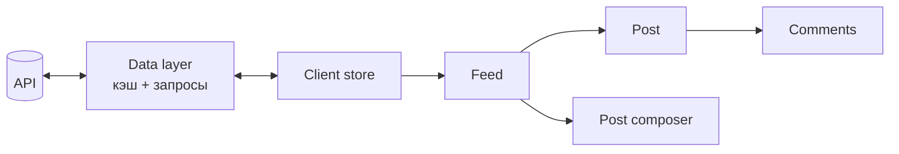

> Спроектируйте ленту новостей: пользователь видит посты друзей, может лайкать и комментировать, лента подгружается при прокрутке.

## Requirements

**Функциональные:**

- Лента постов (текст, изображения) от тех, на кого подписан пользователь.
- Бесконечная прокрутка.
- Создание поста, лайки, комментарии.

**Нефункциональные:**

- Быстрая первая загрузка (LCP < 2.5 с) и плавная прокрутка на длинных лентах.
- Работа на мобильных и при плохой сети.
- Доступность: навигация с клавиатуры, скринридеры.

**Вопросы интервьюеру:** нужен ли realtime (новые посты без перезагрузки)? Какие типы контента? Нужен ли офлайн?

## Architecture



- **Feed** — список постов с виртуализацией и подгрузкой следующей страницы.
- **Post composer** — форма создания поста с оптимистичным добавлением в ленту.
- **Data layer** — запросы, кэш, дедупликация, повтор при ошибках (React Query / RTK Query).
- **Client store** — нормализованные сущности: пост, автор, комментарий.

## Data model

| Сущность | Поля                                              | Где живёт       |
| -------- | ------------------------------------------------- | --------------- |
| `Post`   | `id`, `authorId`, `content`, `createdAt`, `likes` | Серверный кэш   |
| `User`   | `id`, `name`, `avatarUrl`                         | Серверный кэш   |
| `Feed`   | `postIds[]`, `nextCursor`                         | Серверный кэш   |
| Черновик | текст, вложения                                   | Локальный стейт |

Посты и пользователи хранятся **нормализованно** — один пользователь не дублируется в каждом посте, а лайк обновляется в одном месте.

## Interface (API)

```http
GET /feed?cursor=<cursor>&limit=20
→ { posts: Post[], users: User[], nextCursor: string | null }

POST /posts          { content }
POST /posts/:id/like
```

**Курсорная пагинация, а не offset:** при появлении новых постов offset сдвигается и посты дублируются или теряются. Курсор (id или время последнего поста) стабилен.

## Optimizations

- **Производительность:** виртуализация списка; ленивая загрузка изображений с `srcset`; SSR первой страницы ленты; prefetch следующей страницы заранее.
- **UX:** оптимистичные лайки с откатом при ошибке; скелетоны вместо спиннеров; плашка «Новые посты» вместо прыжка ленты.
- **Сеть:** дедупликация запросов, повтор с экспоненциальной задержкой, кэш для мгновенного возврата на ленту.
- **Доступность:** `role="feed"` и `aria-busy` при загрузке, управление фокусом при подгрузке.
- **Безопасность:** санитизация пользовательского контента (XSS).
