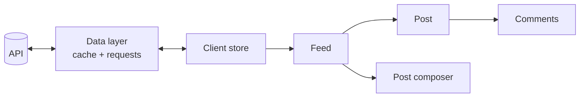

> Design a news feed: the user sees posts from friends, can like and comment, and the feed loads more as you scroll.

## Requirements

**Functional:**

- A feed of posts (text, images) from the people the user follows.
- Infinite scroll.
- Creating a post, likes, comments.

**Non-functional:**

- Fast first load (LCP < 2.5 s) and smooth scrolling on long feeds.
- Works on mobile and on poor networks.
- Accessibility: keyboard navigation, screen readers.

**Questions for the interviewer:** do we need realtime (new posts without reloading)? What content types? Do we need offline?

## Architecture



- **Feed** — a virtualized list of posts that loads the next page.
- **Post composer** — a form for creating a post, optimistically added to the feed.
- **Data layer** — requests, cache, deduplication, retries on errors (React Query / RTK Query).
- **Client store** — normalized entities: post, author, comment.

## Data model

| Entity | Fields                                            | Lives in     |
| ------ | ------------------------------------------------- | ------------ |
| `Post` | `id`, `authorId`, `content`, `createdAt`, `likes` | Server cache |
| `User` | `id`, `name`, `avatarUrl`                         | Server cache |
| `Feed` | `postIds[]`, `nextCursor`                         | Server cache |
| Draft  | text, attachments                                 | Local state  |

Posts and users are stored **normalized** — a user isn't duplicated in every post, and a like is updated in one place.

## Interface (API)

```http
GET /feed?cursor=<cursor>&limit=20
→ { posts: Post[], users: User[], nextCursor: string | null }

POST /posts          { content }
POST /posts/:id/like
```

**Cursor pagination, not offset:** when new posts appear, the offset shifts and posts get duplicated or lost. A cursor (the id or time of the last post) is stable.

## Optimizations

- **Performance:** list virtualization; lazy-loaded images with `srcset`; SSR for the first page of the feed; prefetching the next page ahead of time.
- **UX:** optimistic likes rolled back on error; skeletons instead of spinners; a "New posts" pill instead of the feed jumping.
- **Network:** request deduplication, retries with exponential backoff, a cache for an instant return to the feed.
- **Accessibility:** `role="feed"` and `aria-busy` while loading, focus management when more items load.
- **Security:** sanitize user content (XSS).
